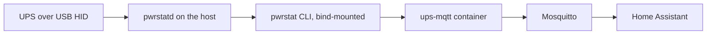

# Twilight Zone UPS load bridge

Publishes the UPS load in watts, read from CyberPower's `pwrstat` CLI, to Home
Assistant over MQTT discovery. One device, one sensor.

| | |
| --- | --- |
| Entity | `sensor.twilightzone_ups_load` |
| State topic | `twilightzone/ups/load` (retained, QoS 1) — the bare number, e.g. `66` |
| Availability | `twilightzone/ups/availability` — `online` / `offline`, plus Last Will |
| Discovery | `homeassistant/sensor/twilightzone_ups/load/config` (retained) |
| Unit / class | `W`, `power`, `state_class: measurement`, `suggested_display_precision: 0` |
| Staleness | `expire_after: 4 × POLL_INTERVAL`, floored at 60 s |

A scalar `state_topic` means no `value_template` and no JSON state object are
needed. With `state_class: measurement`, Home Assistant keeps long-term
statistics; for kilowatt-hours, add an Integration (Riemann sum) helper in the
UI rather than computing it here.

The rationale behind these decisions, the parse contract and the rejected
alternatives are in
[`twilightzone_server_power_tracker_design_outline.md`](twilightzone_server_power_tracker_design_outline.md).

## How it works



The vendor daemon (`pwrstatd`) owns the UPS and stays on the host under systemd.
The bridge runs in a container on the same machine, invokes the bind-mounted CLI
once per `POLL_INTERVAL`, parses the `Load` line, and publishes the number plus
the Home Assistant discovery config.

## Prerequisites

- **Host:** CyberPower PowerPanel for Linux installed, with `pwrstatd.service`
  running and `pwrstat -status` working as root.
- **Docker:** a **rootful** engine on that host. See
  [Constraints](#constraints-that-shape-the-design) for why a rootless engine
  cannot work.
- **Broker:** an MQTT broker reachable from the container, with a username and
  password if anonymous access is disabled.
- **Home Assistant:** the MQTT integration configured against the same broker.
  Discovery is on by default; no manual YAML is needed.
- **Build toolchain:** Go 1.23 (see `go.mod`) and Docker. Neither is needed to
  *run* the container.

## Repository layout

| Path | Responsibility |
| --- | --- |
| `internal/pwrstat` | Runs the CLI with a bounded context and `LC_ALL=C`, parses the `Load` line, classifies failures. Exposes `ErrFieldMissing`, `ErrValueUnparseable` and `IsUnusable`. |
| `internal/config` | Environment parsing, defaults, validation, topic construction, `LoadObjectID`. |
| `internal/ha` | Home Assistant discovery payload for the single `power` sensor. |
| `cmd/ups-mqtt` | MQTT client, startup probe, poll loop, availability state machine, graceful shutdown. |

## What the host actually looks like

Verified on the deployment host (`twilightzone-server`, `192.168.1.46`), not
inferred:

| | |
| --- | --- |
| CLI | `/usr/sbin/pwrstat`, mode `0755 root:root` — world-executable |
| CLI linkage | dynamically linked, needs only `libc.so.6` (no libusb) |
| Daemon socket | `/var/pwrstatd.ipc`, mode `0755 root:root`, **path-based** |
| Socket path | **hardcoded** — `pwrstatd.conf` has no socket/ipc setting |
| Daemon unit | `pwrstatd.service`, `Restart=always`, recreates the socket on restart |

## Constraints that shape the design

- **Local only.** `pwrstat` talks to `pwrstatd` over a local socket; the CLI has
  no host/port option. The bridge must run on the machine with the USB cable.
- **Root inside the container.** Not because of the CLI — it is `0755` — but
  because of the socket: connecting to a unix socket requires *write* permission
  on its inode, and `0755 root:root` grants that only to the owner. The bridge
  therefore runs as uid 0, and the engine must be **rootful**: a rootless engine
  maps container root to a subuid and cannot write that socket.
- **Text output only.** `pwrstat` has no JSON or machine-readable mode, so the
  `Load` line is parsed. A missing or unparsable line is a failed sample, never
  zero.
- **Coarse sampling.** `pwrstatd` samples the UPS on its own cadence and serves
  cached values, so polling faster than a few seconds gains nothing and short
  dips can be invisible.

## Behaviour

### Sampling

- A sample is taken once at startup, before the MQTT connection, and then on a
  `time.Ticker` every `POLL_INTERVAL`.
- The startup probe is what makes configuration errors loud: if the CLI is
  missing or not executable (`IsUnusable`), the process exits with a message
  naming the path instead of running while publishing nothing.
- Each invocation is bounded by `PWRSTAT_TIMEOUT` through the command context,
  plus a 2 s `cmd.WaitDelay` for a stuck child. `config` enforces
  `PWRSTAT_TIMEOUT < POLL_INTERVAL`, so a sample can never overlap the next
  tick: at the defaults, the worst case is 12 s of a 15 s interval.
- The parsed value is published with `strconv.FormatFloat(w, 'f', -1, 64)`, so
  `66` stays `66` and a fractional reading keeps its digits.

### Failure handling

| Failure | Detection | Behaviour |
| --- | --- | --- |
| Binary missing or not executable | `IsUnusable` (`fs.ErrNotExist`, `fs.ErrPermission`, `exec.ErrNotFound`) | Fatal at startup; the CLI can never be run. |
| Daemon not running | non-zero exit with stderr text | Counted; after 3 consecutive failures the entity is marked `offline`. |
| Output drift (no `Load` line) | `ErrFieldMissing` / `ErrValueUnparseable` | Counted like a daemon failure; no value is published. |
| Sample times out | `context.DeadlineExceeded` | Counted; still retryable. |
| Process hangs without exiting | no publish | `expire_after` makes the entity unavailable. |
| Process killed / host reboot | connection drops | Broker publishes the retained Last Will (`offline`). |

### Availability state machine

- Three consecutive failed samples (`offlineThreshold`) publish retained
  `offline` once. The counter keeps incrementing and logging while the outage
  lasts, but the availability message is edge-triggered, not repeated.
- The first successful sample publishes the value and, if the entity was
  offline, publishes `online` once. The value goes first so a crash between the
  two leaves `offline` next to a fresh reading rather than `online` next to a
  stale one.
- The availability flag is a `sync/atomic.Bool` because the MQTT
  `OnConnectHandler` runs on paho's network goroutine. After a broker restart it
  republishes the *current* state, so a reconnect during an outage keeps the
  entity `offline` instead of falsely advertising `online`.
- Clean shutdown publishes `offline` and disconnects with a 250 ms grace, so the
  Last Will is not what ends the session.

## Configuration

Set these in `.env` (see `.env.example`). `MQTT_URL` has **no default** and is
the only required variable.

| Variable | Default | Purpose |
| --- | --- | --- |
| `MQTT_URL` | — (**required**) | Broker URL; must include a scheme and host, e.g. `tcp://192.168.1.46:1883`. |
| `MQTT_USER` / `MQTT_PASS` | empty | Broker credentials; set both or neither. |
| `MQTT_CLIENT_ID` | `twilightzone-ups` | MQTT client identifier. |
| `MQTT_DISCOVERY_PREFIX` | `homeassistant` | Home Assistant discovery prefix; surrounding slashes are trimmed. |
| `MQTT_STATE_PREFIX` | `twilightzone/ups` | Prefix for the state and availability topics. |
| `DEVICE_ID` | `twilightzone_ups` | Stable device identifier, used in topics and entity IDs; letters, digits, `_` and `-` only. |
| `DEVICE_NAME` | `Twilight Zone UPS` | Device name shown in Home Assistant. |
| `DEVICE_MODEL` | `EC850LCD` | Device model shown in Home Assistant. |
| `PWRSTAT_PATH` | `/usr/sbin/pwrstat` | Path to the CLI inside the container. |
| `PWRSTAT_TIMEOUT` | `10` | Seconds allowed per invocation; must be below `POLL_INTERVAL`. |
| `POLL_INTERVAL` | `15` | Seconds between samples. |

`PWRSTAT_HOST_PATH` is a compose-only variable (default `/usr/sbin/pwrstat`); it
selects which host file is bind-mounted over `PWRSTAT_PATH` in the container.

Changing `DEVICE_ID`, `MQTT_STATE_PREFIX` or `MQTT_DISCOVERY_PREFIX` moves the
bridge to new topics. The new discovery config is published automatically, but
the old retained one is not deleted, so Home Assistant keeps the previous entity
as a ghost until you clear it (see [Operations](#operations)).

## Deploy

`pwrstatd` stays on the host under systemd; only the bridge is containerised.
`docker-compose.yml` bind-mounts the CLI (`/usr/sbin/pwrstat`, read-only) and the
daemon socket (`/var/pwrstatd.ipc`, read-write — `connect(2)` on a socket inside
a read-only mount returns `EROFS` on older kernels).

### Through CI

Pushing to `mqtt-ha-integration` runs the `Test and Deploy to Dockhand` workflow:

1. `test` — `go vet ./...` and `go test -race ./...` (checkout, `setup-go` with
   `go-version-file: go.mod`).
2. `deploy` — joins the tailnet, then POSTs to the Dockhand git-stack webhook,
   which rebuilds and recreates the container on `192.168.1.46`.

`deploy` has `needs: test`, so a failing suite never reaches Dockhand.

When Dockhand manages the stack, it writes the stack's variables into `.env`
(plain values) and `.env.dockhand` (encrypted values). The compose file loads
both and treats them as optional, so the same file also runs on a workstation
where neither exists.

### Locally

```sh
cp .env.example .env      # broker URL + credentials
docker compose up -d --build
docker compose logs -f
```

The base image is pinned in the `Dockerfile` as `FROM ubuntu:26.04` literally.
The host is Ubuntu 26.04 and the vendor CLI is dynamically linked against its
libc, so do not lower this to an older base or a musl image (Alpine) — the
mounted binary would fail to load. It is deliberately not a build arg: the
deploy pipeline builds the Dockerfile without compose `build.args`, and an
unpinned value resolves to empty. The image has no CA bundle by default, so the
`Dockerfile` installs `ca-certificates`.

### Verify

```sh
docker compose exec ups-mqtt /usr/sbin/pwrstat -status   # socket works
docker compose ps                                        # health status
docker logs twilightzone-ups-mqtt                        # connect + failure lines
```

In Home Assistant, the MQTT integration shows one device (`twilightzone_ups`)
with one entity, `sensor.twilightzone_ups_load`. To inspect the wire directly:
Settings → Devices & Services → MQTT → Configure → *Listen to a topic* →
`twilightzone/ups/#`. Expect exactly three retained messages: the discovery
config, `twilightzone/ups/availability`, and `twilightzone/ups/load`.

## Testing

```sh
go test ./...
```

The suite uses fixtures of real `pwrstat -status` output and a fake CLI written to
`t.TempDir()` for the collector and `readLoad` tests, so no UPS, daemon or broker
is needed. Coverage is complete for `internal/config`, effectively complete for
`internal/pwrstat` and `internal/ha`, and `readLoad` is covered in
`cmd/ups-mqtt`; `main` itself is MQTT wiring with no unit tests.

`go test -race ./...` needs cgo and therefore a C compiler; CI runs it, some
developer machines cannot. The Dockerfile's build stage uses `CGO_ENABLED=0`.

## Operations

**Health.** The container healthcheck runs `pwrstat -status` every 60 s (10 s
timeout, 3 retries), so a dead daemon or a stale socket moves the container to
`unhealthy` within about three minutes. Docker's restart policy does not act on
health status, so the container keeps running and logs the failures; the entity
is marked unavailable by the state machine independently of the healthcheck.

### Troubleshooting

| Symptom | Check |
| --- | --- |
| Entity shows `unknown` and never gets a value | `docker logs twilightzone-ups-mqtt` — a startup `pwrstat is not usable` line means a bad `PWRSTAT_PATH` or wrong container user. |
| Entity goes `unavailable` after ~45 s | The daemon is unreachable: `sudo systemctl status pwrstatd`, then run `/usr/sbin/pwrstat -status` inside the container. If the daemon was restarted, the mount is stale. |
| Container `unhealthy` | Same causes as above. The healthcheck is slower than the state machine (three failed probes at 60 s), so the entity usually reports `unavailable` first. |
| Entity exists but stays stale | `expire_after` should mark it unavailable; if it does not, the discovery config never arrived. Listen on `homeassistant/sensor/twilightzone_ups/#`. |
| Ghost entity after renaming topics | Delete the old retained discovery config and state topic with `mosquitto_pub -r -n`. |

**Known limitation: stale socket.** `pwrstatd` is `Restart=always` and recreates
`/var/pwrstatd.ipc` when it restarts, leaving the old inode mounted in the
container. Every `pwrstat` call then fails until the container is recreated:

```sh
docker compose restart ups-mqtt
```

The socket path is hardcoded, so there is no clean way to mount a directory
instead. The failure is visible (entity unavailable, container unhealthy) rather
than silent: the availability state machine marks the entity offline after three
failures.

**Fallback.** If the stale-socket restarts are unacceptable, run the same binary
directly on the host under systemd — as root, `After=pwrstatd.service`,
`EnvironmentFile=`, `Restart=on-failure`. That removes the mount, the glibc
coupling and the staleness problem.

**Deleting a retained topic.** An empty payload with the retain flag set is what
removes a retained message; without `-r` it only publishes a live empty message:

```sh
mosquitto_pub -h 192.168.1.46 -r -n -t '<topic>'
```

This is how the starter's ghost topics
(`homeassistant/sensor/twilightzone_ups/bridge_status/config` and
`twilightzone/ups/bridge_status`) were removed. If a stale entity survives in
Home Assistant after its discovery topic is deleted, delete it from the MQTT
entity registry.

## Out of scope

Battery capacity, runtime, state flags, test results, outage history, thresholds
and energy accounting are deliberately not implemented. Two findings from the
hardware make some of them pointless anyway: `Test Result` never populates on
this model, and `State` was only ever observed as `Normal` — a self-test that ran
the load on battery left no trace in the status output or the daemon log.
