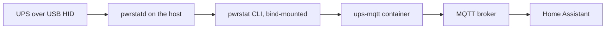

# Twilight Zone power tracker

Two independent services that put power data into Home Assistant:

| Service | What it adds | Needs |
| --- | --- | --- |
| **UPS load bridge** (Go + MQTT) | Live UPS load in watts, e.g. `sensor.twilightzone_ups_load` | A CyberPower UPS and a Linux host running PowerPanel |
| **DTE Energy usage integration** (Python) | Whole-home electric and gas usage, priced with DTE tariffs, in the Energy dashboard | A DTE Energy account and its Green Button share link |

Use one or both. They do not depend on each other.

**Contents**

- [Part 1: UPS load bridge](#part-1-ups-load-bridge)
  - [How it works](#how-it-works)
  - [Before you start](#before-you-start)
  - [Install the UPS daemon](#1-install-the-ups-daemon)
  - [Configure](#2-configure)
  - [Start the bridge](#3-start-the-bridge)
  - [Verify in Home Assistant](#4-verify-in-home-assistant)
  - [Configuration reference](#configuration-reference)
  - [Troubleshooting](#ups-troubleshooting)
  - [Why root, and the stale-socket caveat](#why-root-and-the-stale-socket-caveat)
- [Part 2: DTE Energy usage](#part-2-dte-energy-usage)
  - [What you get](#what-you-get)
  - [Before you start](#dte-before-you-start)
  - [Get the share link](#1-get-the-share-link)
  - [Install the integration](#2-install-the-integration)
  - [Add the integration](#3-add-the-integration)
  - [Energy dashboard: electricity](#4-energy-dashboard-electricity)
  - [Energy dashboard: gas](#5-energy-dashboard-gas)
  - [Rate chart](#6-optional-rate-chart)
  - [Rates and how to update them](#rates-and-how-to-update-them)
  - [Troubleshooting](#dte-troubleshooting)
- [Development](#development)
- [Design notes](#design-notes)
- [Security](#security)
- [Out of scope](#out-of-scope)

---

# Part 1: UPS load bridge

Publishes the UPS load in watts, read from CyberPower's `pwrstat` CLI, to Home
Assistant over MQTT discovery. One device, one sensor.

With the default settings:

| | |
| --- | --- |
| Entity | `sensor.twilightzone_ups_load` |
| State topic | `twilightzone/ups/load` (retained, QoS 1) — the bare number, e.g. `66` |
| Availability | `twilightzone/ups/availability` — `online` / `offline`, plus Last Will |
| Discovery | `homeassistant/sensor/twilightzone_ups/load/config` (retained) |
| Unit / class | `W`, `power`, `state_class: measurement` |
| Staleness | `expire_after: 4 × POLL_INTERVAL`, floored at 60 s |

The sensor is a power measurement. If you want kilowatt-hours, add a
**Riemann sum** helper in Home Assistant; the bridge does not compute energy.

## How it works



`pwrstatd` owns the UPS and runs on the host under systemd. The bridge runs in a
container on the same machine, calls the bind-mounted CLI once per
`POLL_INTERVAL`, parses the `Load` line and publishes the value plus the Home
Assistant discovery config.

## Before you start

You need:

- **Hardware:** a CyberPower UPS connected to the host by USB.
- **Host:** Linux with [CyberPower PowerPanel for
  Linux](https://www.cyberpowersystems.com/product/software/powerpanel/powerpanel-linux/)
  installed. Its `pwrstatd` service must be running and `sudo pwrstat -status`
  must work.
- **Docker:** a **rootful** Docker Engine on that host. Rootless Docker cannot
  reach the daemon socket; see [Why root](#why-root-and-the-stale-socket-caveat).
- **MQTT broker:** reachable from the container, with credentials if anonymous
  access is disabled.
- **Home Assistant:** the **MQTT** integration configured against the same
  broker. Discovery is on by default.
- **To build outside Docker:** Go 1.23 or newer. Not needed to run the
  container.

## 1. Install the UPS daemon

Install PowerPanel for Linux using CyberPower's package, then enable and start
the daemon:

```sh
sudo systemctl enable --now pwrstatd.service
sudo pwrstat -status
```

The status output should include a `Load` value. If it does not, fix that
before continuing; the bridge cannot invent the number.

## 2. Configure

```sh
git clone https://github.com/AlienBob93/twilightzone_server_power_tracker.git
cd twilightzone_server_power_tracker
cp .env.example .env
```

Edit `.env` and set at least the broker URL:

```dotenv
MQTT_URL=tcp://192.168.1.10:1883
MQTT_USER=
MQTT_PASS=
```

`MQTT_URL` has no default and is the only required variable. Set both
`MQTT_USER` and `MQTT_PASS`, or neither.

The full list is in [Configuration reference](#configuration-reference).

## 3. Start the bridge

```sh
docker compose up -d --build
docker compose logs -f
```

The container bind-mounts:

- `/usr/sbin/pwrstat` from the host, read-only, over `PWRSTAT_PATH`.
- `/var/pwrstatd.ipc` from the host, read-write. A unix socket inside a
  read-only mount cannot be connected to on some kernels.
- `.env` and, if it exists, `.env.dockhand`. Dockhand writes the latter; it is
  optional, so the same compose file also runs without it.

The base image is pinned to `ubuntu:26.04` because the vendor CLI is
dynamically linked against that libc. Do not replace it with an older Ubuntu or
a musl image such as Alpine; the mounted binary will fail to load. If your host
runs a different distribution, choose a runtime base whose glibc is at least as
new as the host's.

## 4. Verify in Home Assistant

1. The MQTT integration should discover one device (default
   `twilightzone_ups`) with one entity (`sensor.twilightzone_ups_load`).
2. Open **Settings → Devices & services → MQTT → Configure → Listen to a
   topic** and subscribe to `twilightzone/ups/#`. With the defaults you should
   see three retained messages: the discovery config, availability and load.
3. Check the container:

```sh
docker compose ps
docker compose exec ups-mqtt /usr/sbin/pwrstat -status
docker logs twilightzone-ups-mqtt
```

## Configuration reference

Set these in `.env`.

| Variable | Default | Purpose |
| --- | --- | --- |
| `MQTT_URL` | — (**required**) | Broker URL with scheme and host, e.g. `tcp://192.168.1.10:1883`. |
| `MQTT_USER` / `MQTT_PASS` | empty | Broker credentials; set both or neither. |
| `MQTT_CLIENT_ID` | `twilightzone-ups` | MQTT client identifier. |
| `MQTT_DISCOVERY_PREFIX` | `homeassistant` | Home Assistant discovery prefix. |
| `MQTT_STATE_PREFIX` | `twilightzone/ups` | Prefix for state and availability topics. |
| `DEVICE_ID` | `twilightzone_ups` | Stable device identifier; letters, digits, `_` and `-`. |
| `DEVICE_NAME` | `Twilight Zone UPS` | Device name in Home Assistant. |
| `DEVICE_MODEL` | `EC850LCD` | Model shown in Home Assistant. |
| `PWRSTAT_PATH` | `/usr/sbin/pwrstat` | CLI path inside the container. |
| `PWRSTAT_TIMEOUT` | `10` | Seconds per CLI call; must be below `POLL_INTERVAL`. |
| `POLL_INTERVAL` | `15` | Seconds between samples. |

`PWRSTAT_HOST_PATH` is compose-only and defaults to `/usr/sbin/pwrstat`. It
selects the host file mounted over `PWRSTAT_PATH`.

Changing `DEVICE_ID`, `MQTT_STATE_PREFIX` or `MQTT_DISCOVERY_PREFIX` moves the
bridge to new topics. The new discovery config is published; the old retained
one is not deleted, so Home Assistant keeps the old entity until you remove it
(see [Deleting a retained topic](#deleting-a-retained-topic)).

## UPS troubleshooting

| Symptom | Check |
| --- | --- |
| Entity stays `unknown` | `docker logs twilightzone-ups-mqtt`. A startup `pwrstat is not usable` line means a bad `PWRSTAT_PATH` or wrong container user. |
| Entity becomes `unavailable` after ~45 s | The daemon is unreachable. Run `sudo systemctl status pwrstatd`, then `/usr/sbin/pwrstat -status` inside the container. If the daemon restarted, the socket mount is stale. |
| Container is `unhealthy` | Same causes. The healthcheck runs every 60 s, so the entity usually goes unavailable first. |
| Entity is stale | `expire_after` should mark it unavailable. If not, the discovery config never arrived; listen on `homeassistant/sensor/twilightzone_ups/#`. |
| Ghost entity after renaming | Remove the old retained discovery and state topics. |

### Deleting a retained topic

An empty payload with the retain flag removes a retained message. Without `-r`
it only publishes a live empty message:

```sh
mosquitto_pub -h <broker-host> -r -n -t '<topic>'
```

If a stale entity remains in Home Assistant after the discovery topic is gone,
delete it from the MQTT entity registry.

### Why root, and the stale-socket caveat

The container runs as root because of the **daemon socket**, not the CLI. The
CLI is world-executable, but connecting to a unix socket requires write
permission on its inode, and `/var/pwrstatd.ipc` is `0755 root:root`. A
rootless engine maps container root to a subuid and cannot write it.

`pwrstatd` recreates `/var/pwrstatd.ipc` when it restarts, leaving the old inode
mounted in the container. Calls then fail until the container is recreated:

```sh
docker compose restart ups-mqtt
```

The failure is visible: the entity is marked offline after three failed samples
and the container becomes unhealthy.

If those restarts are unacceptable, run the same binary directly on the host
under systemd as root, with `After=pwrstatd.service`, an `EnvironmentFile=` and
`Restart=on-failure`. That removes the mount, the glibc coupling and the stale
socket problem.

### Automated deploy (optional)

The repository's GitHub Actions workflow runs `go vet ./...` and
`go test -race ./...`, then optionally triggers a Dockhand stack webhook. If you
do not use Dockhand, delete or adapt the `deploy` job; the UPS bridge does not
need CI.

---

# Part 2: DTE Energy usage

A custom Home Assistant integration,
[`custom_components/dte_energy`](custom_components/dte_energy), for **DTE
Energy residential accounts in Michigan**. It reads DTE's Green Button share
link and writes long-term statistics for the Energy dashboard:

- Hourly electric consumption, split into the tariff bands (off-peak, mid-peak,
  peak, critical).
- Electric cost at DTE's time-of-day rates.
- Daily gas consumption and cost at DTE Gas Rate A.
- Price and rate-period sensors for automations and charts.

Nothing about the UPS bridge is used here. The integration is independent.

## What you get

| Statistic | Unit | Use |
| --- | --- | --- |
| `dte_energy:grid_consumption` | kWh | Combined electric consumption |
| `dte_energy:grid_cost` | USD | Combined electric cost |
| `dte_energy:off_peak_consumption` / `_cost` | kWh / USD | Off-peak |
| `dte_energy:mid_peak_consumption` / `_cost` | kWh / USD | Mid-peak (Dynamic Peak Pricing history) |
| `dte_energy:peak_consumption` / `_cost` | kWh / USD | Peak |
| `dte_energy:critical_consumption` / `_cost` | kWh / USD | Critical event hours, once event dates are configured |
| `dte_energy:gas_consumption` | CCF | Daily gas usage |
| `dte_energy:gas_cost` | USD | Daily gas cost |

Entities:

| Entity | Meaning |
| --- | --- |
| `sensor.dte_energy_current_price` | Current electric rate in USD/kWh |
| `sensor.dte_energy_current_band` | `off_peak`, `mid_peak`, `peak` or `critical` |
| `sensor.dte_energy_next_rate_change` | Next tariff boundary |
| `sensor.dte_energy_last_reading` | Newest interval in the DTE feed (diagnostic) |
| `sensor.dte_energy_last_import` | Last successful statistics import (diagnostic) |

Home Assistant cannot price **external** statistics from an entity, so the
integration imports the cost series itself. The full history in the share link
is backfilled on first setup.

## DTE before you start

- A DTE Energy account with an advanced meter and access to **Energy Usage
  Data**.
- Home Assistant 2026.11 or newer for the built-in Marketplace, or HACS on
  older versions, or manual installation.
- The recorder enabled (the default). The Energy dashboard needs long-term
  statistics.

## 1. Get the share link

1. Sign in at DTE's **Energy Usage Data** site
   ([usage.dteenergy.com](https://usage.dteenergy.com/)).
2. Create or open the usage-data share, choose the electric and gas data, and
   copy the link. It is a Green Button XML feed.
3. Treat the link as a secret: anyone who has it can read your usage history.

The feed contains hourly electric kWh and daily gas CCF. It does **not** contain
prices; the integration applies the tariffs locally.

## 2. Install the integration

### Home Assistant 2026.11 or newer (Marketplace)

1. **Settings → Marketplace → Add from link**.
2. Enter `https://github.com/AlienBob93/twilightzone_server_power_tracker`.
3. Select **Add** (choose **Integration** if asked for a type).
4. Open the repository and install **DTE Energy Usage**.
5. Approve the GitHub device connection if prompted.

### HACS (Home Assistant 2026.10 or older)

1. HACS → three-dot menu → **Custom repositories**.
2. Add `https://github.com/AlienBob93/twilightzone_server_power_tracker` as an
   **Integration**.
3. Search for **DTE Energy Usage** and download it.

HACS is replaced by the Marketplace in Home Assistant 2026.11, so this path is
only for older installations. The integration itself needs Home Assistant
2025.10 or newer.

### Manual

Copy `custom_components/dte_energy` into your Home Assistant `config` directory
and restart Home Assistant.

## 3. Add the integration

1. **Settings → Devices & services → Add integration → DTE Energy Usage**.
2. Paste the share link.
3. Optional: open **Configure** to change the polling interval (1–24 hours) or
   to add Dynamic Peak Pricing **critical-event dates**.

Without critical-event dates, event hours are priced at the normal peak rate.
Adding or changing dates triggers a full re-cost of the electric history.

## 4. Energy dashboard: electricity

Choose **one** layout. Using both counts every kWh twice.

### Option A: one combined connection

1. **Settings → Dashboards → Energy → Electricity grid → Add grid connection**.
2. Consumption: `dte_energy:grid_consumption`.
3. Cost: **Use an entity tracking the total costs** → `dte_energy:grid_cost`.
4. Save.

### Option B: split by tariff (recommended)

1. Remove any combined DTE grid connection.
2. Add one grid connection per band:

   | Connection | Consumption | Cost |
   | --- | --- | --- |
   | DTE off-peak | `dte_energy:off_peak_consumption` | `dte_energy:off_peak_cost` |
   | DTE mid-peak | `dte_energy:mid_peak_consumption` | `dte_energy:mid_peak_cost` |
   | DTE peak | `dte_energy:peak_consumption` | `dte_energy:peak_cost` |
   | DTE critical | `dte_energy:critical_consumption` | `dte_energy:critical_cost` |

3. Add every band that has data. `mid_peak` exists for the Dynamic Peak
   Pricing history; `critical` only appears after you configure event dates.

The sources table and usage graph then split peak vs. off-peak on the default
Energy panel, and each band is priced at its own rate.

The picker searches statistics by **ID**, not by display name. If a name does
not appear, type `peak_consumption`, `off_peak_cost`, etc. The price sensor is
for charts and automations; the dashboard cost option must use a cost
statistic.

## 5. Energy dashboard: gas

The gas data is daily. Each day's total is placed at local midnight.

1. In the Energy dashboard, open the **Gas** step.
2. Add a gas source and choose `dte_energy:gas_consumption`.
3. Under cost, choose **Use an entity tracking the total costs** and select
   `dte_energy:gas_cost`.

The monthly customer charge, IRM surcharge and sales tax are applied on the
first imported day of each month. A day-one spike is expected; the monthly
total is what matters.

## 6. Optional rate chart

The Energy dashboard charts cost, not the tariff. To see the rate steps, add a
card to a normal dashboard:

```yaml
type: statistics-graph
title: DTE electricity price
chart_type: line
period: hour
days_to_show: 3
entities:
  - entity: sensor.dte_energy_current_price
```

For exact one-hour steps, use `history-graph` with `current_price` or
`current_band`.

## Rates and how to update them

The defaults model a DTE residential account with these plans:

| Plan | Off-peak | Mid-peak | Peak | Critical |
| --- | --- | --- | --- | --- |
| Dynamic Peak Pricing (through 2026-12-08) | 14.31¢ | 18.61¢ | 26.92¢ | $1.05 |
| Time of Day 3–7 p.m. (from 2026-12-09) | 18.44¢ | — | 24.13¢ summer / 20.05¢ non-summer | — |

Dynamic Peak Pricing runs off-peak 23:00–07:00, mid-peak 07:00–15:00 and
19:00–23:00, and peak 15:00–19:00. Time of Day has peak 15:00–19:00 on
weekdays and off-peak at all other times. All times are `America/Detroit`;
weekends and DTE's designated holidays are off-peak.

The electric table is in
[`tariff.py`](custom_components/dte_energy/tariff.py). The gas table is in
[`gas_tariff.py`](custom_components/dte_energy/gas_tariff.py) and defaults to
**DTE Gas Rate A / GCR** from the November 2026 rate card, with the 4% Michigan
sales tax and no City of Detroit utility users tax. The November 2026 Rate A
total is **$0.95012/Ccf** plus a **$15.40** monthly customer charge; earlier
months use the monthly values from the rate card. It is set up for a Washtenaw
County account.

If your rate schedule, effective dates, county tax or gas supplier differs:

1. Edit the table.
2. Bump `TARIFF_VERSION` (electric) or `GAS_TARIFF_VERSION` (gas).
3. Restart the integration.

The bump makes the integration re-cost the full history. Electric rates are
base rates and exclude PSCR, taxes and program fees; gas includes the 4% sales
tax because it is a single known rate. Verify against your bill.

If the apartment or building is master-metered on **Rate 2A** instead of Rate
A, use Rate 2A's values: Meter Class I was $0.97270/Ccf with the same $15.40
customer charge; Meter Class II had a $55.00 customer charge.

## DTE troubleshooting

| Symptom | Check |
| --- | --- |
| No statistics in the Energy picker | **Developer tools → Statistics**; confirm both the energy and cost statistic IDs exist. The first import can take a minute. |
| Picker cannot find a name | Search by statistic ID, e.g. `peak_consumption`. |
| Energy total is doubled | You have both the combined and the per-band connections. Remove one set. |
| Gas cost looks wrong on the 1st | The monthly fixed charge and tax are billed there. Look at the monthly total. |
| Critical band is missing | Configure Dynamic Peak Pricing event dates, then wait for the re-cost. |
| New data is missing | DTE posts with a one- to two-day lag. Check `sensor.dte_energy_last_reading`. |
| Link rejected during setup | The URL must be an `https://…dteenergy.com` share link that returns the XML feed. Re-copy it from DTE. |
| Gas rate does not match the bill | Check Rate A vs. 2A, GCR vs. GCC, and your county/city tax. Adjust `gas_tariff.py`. |

## Behaviour and caveats

- DTE posts readings with a one- to two-day lag; the integration polls every
  six hours by default.
- DTE can revise estimated readings. The last three days are re-imported on
  every poll; older revisions are ignored.
- The integration backfills the whole feed on first setup (about 14 months in
  the current export).
- The share link grants read access to your usage history. It is stored in the
  config entry; treat it as a secret.
- The integration is DTE-specific. The UPS bridge is not.

---

# Development

Repository layout:

| Path | Responsibility |
| --- | --- |
| `cmd/ups-mqtt` | MQTT client, startup probe, poll loop, availability, shutdown. |
| `internal/pwrstat` | Runs the CLI, parses the `Load` line, classifies failures. |
| `internal/config` | Environment parsing, defaults, validation, topics, entity ID. |
| `internal/ha` | Home Assistant discovery payload. |
| `custom_components/dte_energy` | DTE Energy usage integration. |
| `tests` | Python tests for the tariff and Green Button parser. |

Tests:

```sh
go test ./...
go test -race ./...     # needs cgo and a C compiler
python3 -m unittest discover -s tests
```

The Go suite uses real `pwrstat` fixtures and a fake CLI, so no UPS, daemon or
broker is needed. The Python suite is standalone and needs no Home Assistant
install.

# Design notes

The detailed rationale, parse contract, rejected alternatives and verified host
details are in
[`twilightzone_server_power_tracker_design_outline.md`](twilightzone_server_power_tracker_design_outline.md).

# Security

- `.env` contains MQTT credentials and is ignored by git. Never commit it.
- The DTE share link is a secret. It is stored in Home Assistant's config entry
  and should not be posted publicly.
- The repository is public because the Marketplace/HACS install reads it; it
  contains no credentials or share links.
- Run the UPS bridge on a trusted host: it mounts the daemon socket and runs as
  root inside the container.

# Out of scope

Battery capacity, runtime, state flags, test results, outage history and
thresholds are not implemented in the UPS bridge. On the tested model,
`Test Result` never populated and `State` was only ever `Normal`, so those
fields would not help anyway.

Whole-home energy accounting is handled by the DTE integration, not by the UPS
bridge. The UPS sensor stays a power measurement; use a Riemann-sum helper if
you want the server's own kWh.
